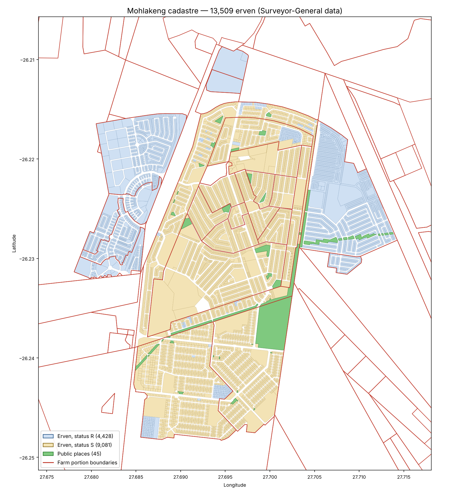

# Mohlakeng cadastral data

Erf (plot) boundaries for Mohlakeng, Rand West City Local Municipality, Gauteng, downloaded
on 11 October 2026 from the Chief Surveyor-General's National Cadastral Layer.



## Files

| File | Open with | Contents |
|---|---|---|
| `Mohlakeng_cadastre.kmz` | Google Earth | Erven, public places and surrounding farm portions; click a plot for its details |
| `Mohlakeng_erven_list.xlsx` | Excel | One row per erf: number, SG 21-digit key, area (m²), latitude/longitude |
| `Mohlakeng_cadastre_shapefiles.zip` | QGIS, ArcGIS, AutoCAD Map, Civil 3D | Shapefiles in two coordinate systems: `WGS84_latlong` and `Lo27_Hartebeesthoek94` (SA survey system) |
| `Mohlakeng_cadastre.gpkg` | QGIS, ArcGIS | The same three layers in a single file (WGS84) |
| `Mohlakeng_cadastre_preview.png` | Any image viewer | Overview map |

## What's included

- **13,509 erven** in the SG township "MOHLAKENG" (code `T0IQ0579`, registration division IQ),
  erf numbers 1 to 16,877. The SG data holds the original township and its extensions under
  this one township code.
- **45 public places** (parks and open spaces).
- **65 farm portions** of Middelvlei 255-IQ, Luipaardsvlei 243-IQ and Toekomsrus 242-IQ that
  overlap the township's extent, for land around and under Mohlakeng.

## Notes

- **Area (m²)** is calculated from each boundary. The SG's own `GEOM_AREA` field was left out
  because it is about 12% too large for erven with status `S`. On a sample of erven checked
  against the Esri South Africa cadastre, the calculated areas agreed to within 0.1 m².
- **LSTATUS / WSTATUS** are copied as the SG publishes them: 4,428 erven are `R`/`C`, 9,081 are `S`.
  Confirm what they mean with the Surveyor-General or Deeds Office before relying on them.
- This is a GIS dataset, not a legal survey. For legal boundaries, get the SG diagram or general
  plan from the Surveyor-General's Pretoria office and use a registered land surveyor.

## Refreshing the data

```
pip install geopandas pyogrio openpyxl matplotlib
python fetch_mohlakeng_cadastre.py
python make_preview_map.py Mohlakeng_cadastre.gpkg Mohlakeng_cadastre_preview.png
```
