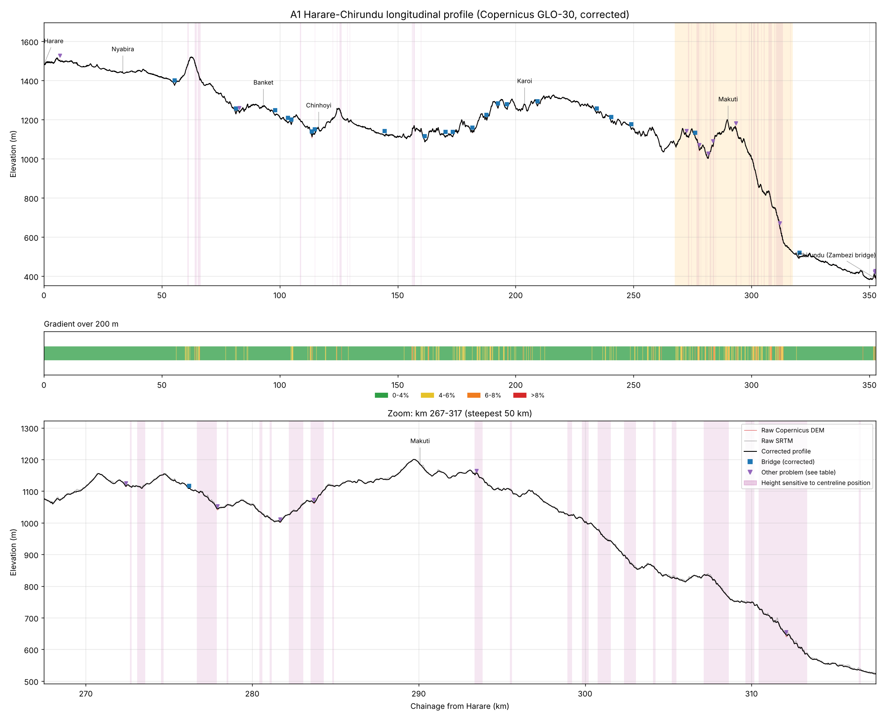
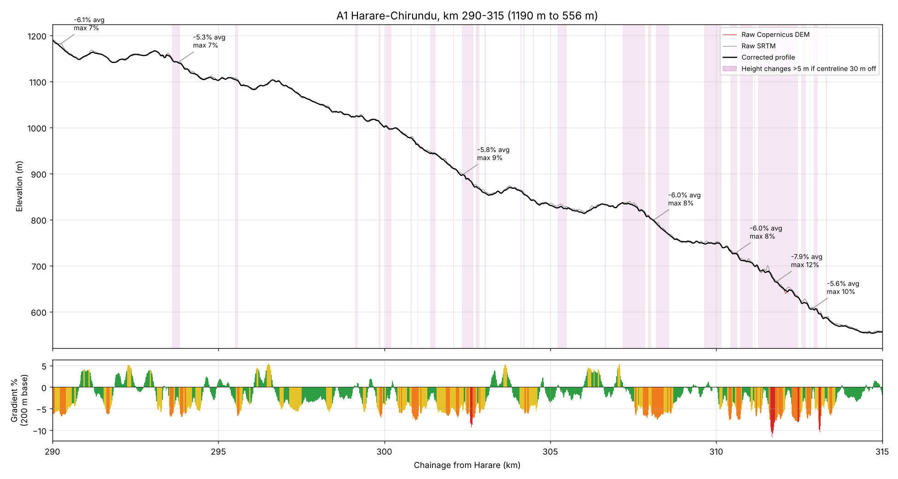

# A1 Harare–Chirundu: inception terrain package

Contours, longitudinal profile and gradients for the A1 (now numbered **R3**), from central
Harare to the Zimbabwe bank of the Zambezi bridge at Chirundu. All data is free and global, so
this is **inception level**: good for comparing routes and spotting problem sections, not for design.



## Key results

| | |
|---|---|
| Length | 352.8 km (ground chainage), km 0 in central Harare |
| Elevation | 1,481 m at Harare, 1,520 m highest (Great Dyke, km 63), 387 m at the Zambezi bridge |
| Escarpment | km 290–315: Makuti (1,190 m) down to 556 m, 634 m fall; steepest point 11.6% at km 311.7 |
| Steep sections (6% or more over 200 m) | 28 sections, listed in the Excel file |
| Largest raw drop in the profile | 9 m, at the Manyame River bridge (km 113.6), corrected |



## Why earlier profiles showed 50 m drops

With an accurate centreline, nothing on this road drops more than 9 m. The large drops come from the
centreline not being on the real road:

- Centreline **30 m** off: height changes by up to **17 m**.
- Centreline **100 m** off: height changes by up to **57 m** (km 311.6, escarpment hairpins).
- A coarser 90 m DEM on the correct centreline: up to **11 m** only.

Every profile point in the Excel file shows how much its height would change if the centreline
were 30 m out. The pink bands on the charts mark where that change is more than 5 m.

## Files

| File | Open with | Contents |
|---|---|---|
| `A1_Harare_Chirundu_terrain.kmz` | Google Earth | Centreline coloured by gradient, km markers, 10 m and 50 m contours, bridges, flagged problems |
| `A1_Harare_Chirundu_plan_contours_UTM35S.dxf` | AutoCAD | Contours with elevations (10 m and 50 m layers), 3D centreline, gradient layers, km ticks |
| `A1_Harare_Chirundu_long_section.dxf` | AutoCAD | Long section, vertical exaggeration ×10, raw and corrected ground, steep-section bars |
| `A1_Harare_Chirundu_Civil3D_alignment_profile.xml` | Civil 3D | LandXML alignment with two existing-ground profiles (corrected and raw) |
| `A1_Harare_Chirundu_Civil3D_surface_DEM_UTM35S.tif` | Civil 3D, QGIS | 30 m ground surface for the 2 km wide corridor |
| `A1_Harare_Chirundu_profile_and_steep_sections.xlsx` | Excel | Steep sections, profile problems, towns, km markers, profile every 20 m |
| `A1_Harare_Chirundu_profile.png` | Any | Full profile and gradient band |
| `A1_Harare_Chirundu_steep_sections_map.png` | Any | Map of gradients with an escarpment zoom |
| `A1_Harare_Chirundu_km290-315_escarpment.png` | Any | Close-up of the escarpment |

## Using it in Civil 3D

1. Set the drawing coordinate system to **UTM84-35S** (Settings → Drawing Settings → Units and Zone).
2. **Surface:** Create Surface (TIN) → Definition → DEM Files → Add → the `.tif`.
   Or add the contour polylines from the plan DXF as contour data.
3. **Alignment and profile:** Insert → LandXML → the `.xml`. This creates the alignment and the two
   existing-ground profiles. The alignment is straight segments within 1 m of the mapped road; fit
   curves before design work.
4. Civil 3D stations are UTM grid distances, which run about 0.07% ahead of ground chainage (242 m by
   Chirundu). The Excel profile lists both.

## Sources and accuracy

- **Centreline:** Overture Maps release 2026-09-23, from OpenStreetMap. Typically within 5–10 m.
- **Elevation:** Copernicus GLO-30 DEM (30 m, EGM2008 heights), checked against SRTM 1 arc-second.
  The two agree to within 4.8 m on 90% of the road. Copernicus is a surface model, so trees and
  buildings can raise it.
- **Corrections:** bridges in the map data are bridged in the profile. Other spikes or drops of more
  than 5 m against a 310 m running median are interpolated and listed in the Excel file.
- **Coordinates:** WGS 84 / UTM zone 35S. Harare lies outside zone 35, so distances near Harare read
  about 0.2% long.
- For design, commission LiDAR or a ground survey, especially for km 270–315.

## Rebuilding

```
pip install geopandas pyarrow rasterio contourpy ezdxf networkx scipy pyproj matplotlib openpyxl
python build_a1_corridor.py OUTPUT_DIR CACHE_DIR
python section_chart.py OUTPUT_DIR/A1_Harare_Chirundu_profile_and_steep_sections.xlsx 290 315 chart.png
```

The build downloads about 400 MB (elevation tiles and Overture data) into `CACHE_DIR`. Network
access is needed to `copernicus-dem-30m.s3.amazonaws.com`, `elevation-tiles-prod.s3.amazonaws.com`
and `overturemaps-us-west-2.s3.us-west-2.amazonaws.com`.
